# Session 10: Kubernetes Pods, ReplicaSets & Deployments

## Overview

This session explores Kubernetes Pods, ReplicaSets, Deployments, deployment strategies, and the Pod lifecycle. Practical exercises demonstrate how to update applications, switch between application versions, deploy a canary version, and observe Pod creation, running, termination, and restart behavior.

## Objectives

- Understand Pods, ReplicaSets, and Deployments.
- Implement Rolling Update, Blue-Green, Canary, and Recreate deployment strategies.
- Update application versions and verify Pod changes.
- Study and demonstrate the Kubernetes Pod lifecycle.
- Apply YAML manifests and inspect resources using `kubectl`.
- Capture screenshots of command outputs and document observations.
- Push all work to GitHub.

## Tools and Technologies

- Kubernetes
- Minikube
- kubectl
- Docker
- NGINX
- Windows PowerShell
- YAML
- Git and GitHub

---

# Task 1: Deployment Strategies

## 1. Rolling Update

A Rolling Update gradually replaces old Pods with new Pods while keeping the application available whenever possible.

### Step 1: Create the Deployment

Create `deployments/rolling-update.yaml`:

```yaml
apiVersion: apps/v1
kind: Deployment
metadata:
  name: rolling-app
spec:
  replicas: 3
  strategy:
    type: RollingUpdate
    rollingUpdate:
      maxSurge: 1
      maxUnavailable: 0
  selector:
    matchLabels:
      app: rolling-app
  template:
    metadata:
      labels:
        app: rolling-app
        version: v1
    spec:
      containers:
        - name: nginx
          image: nginx:1.26
          ports:
            - containerPort: 80
```

Apply the manifest:

```powershell
kubectl apply -f deployments/rolling-update.yaml
kubectl rollout status deployment/rolling-app
kubectl get deployment rolling-app
kubectl get pods -l app=rolling-app
```

### Step 2: Update the Application

Update the container image:

```powershell
kubectl set image deployment/rolling-app nginx=nginx:1.27
kubectl rollout status deployment/rolling-app
```

### Step 3: Verify Old and New Pods

```powershell
kubectl get replicasets
kubectl get pods -l app=rolling-app -o wide
kubectl describe deployment rolling-app
kubectl rollout history deployment/rolling-app
```

### Observation

- Kubernetes creates replacement Pods gradually.
- Old Pods are terminated as new Pods become available.
- `maxSurge: 1` permits one extra Pod above the desired replica count.
- `maxUnavailable: 0` prevents the Deployment controller from intentionally reducing available replicas during the rollout.

### Screenshots

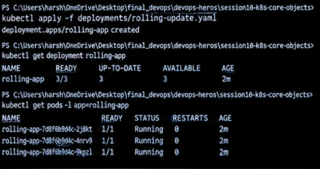

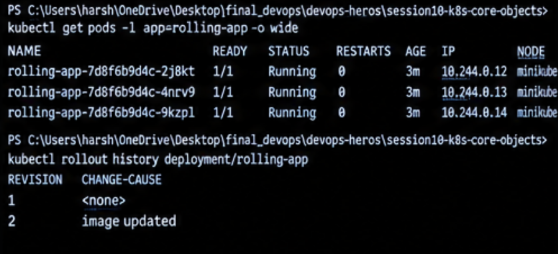

---

## 2. Blue-Green Deployment

Blue-Green deployment maintains two application versions: Blue is the currently active version, and Green is the new version. Traffic is switched by changing the Service selector.

### Step 1: Create the Blue Version

Create `deployments/blue-green.yaml`:

```yaml
apiVersion: apps/v1
kind: Deployment
metadata:
  name: blue-app
spec:
  replicas: 2
  selector:
    matchLabels:
      app: demo-app
      version: blue
  template:
    metadata:
      labels:
        app: demo-app
        version: blue
    spec:
      containers:
        - name: nginx
          image: nginx:1.26
          ports:
            - containerPort: 80
---
apiVersion: apps/v1
kind: Deployment
metadata:
  name: green-app
spec:
  replicas: 2
  selector:
    matchLabels:
      app: demo-app
      version: green
  template:
    metadata:
      labels:
        app: demo-app
        version: green
    spec:
      containers:
        - name: nginx
          image: nginx:1.27
          ports:
            - containerPort: 80
---
apiVersion: v1
kind: Service
metadata:
  name: demo-service
spec:
  type: NodePort
  selector:
    app: demo-app
    version: blue
  ports:
    - port: 80
      targetPort: 80
```

Apply and verify:

```powershell
kubectl apply -f deployments/blue-green.yaml
kubectl rollout status deployment/blue-app
kubectl rollout status deployment/green-app
kubectl get deployments
kubectl get pods --show-labels
kubectl get service demo-service
kubectl get endpoints demo-service
```

Initially, the Service selects the Blue Pods.

### Step 2: Switch Traffic to Green

```powershell
kubectl patch service demo-service -p "{\"spec\":{\"selector\":{\"app\":\"demo-app\",\"version\":\"green\"}}}"
```

Verify the switch:

```powershell
kubectl get service demo-service -o yaml
kubectl get endpoints demo-service
kubectl get pods -l version=green
```

### Step 3: Switch Back to Blue

```powershell
kubectl patch service demo-service -p "{\"spec\":{\"selector\":{\"app\":\"demo-app\",\"version\":\"blue\"}}}"
kubectl get endpoints demo-service
```

### Observation

- Both versions run at the same time.
- The Service selector determines which version receives traffic.
- Switching the selector changes the selected Pods without requiring a Deployment image update.
- This example uses NGINX images; to visibly distinguish the versions in a browser, use images with different application content.

### Screenshots

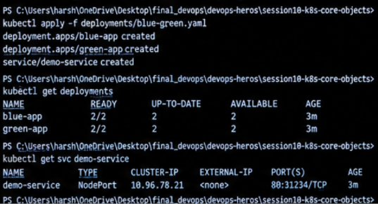

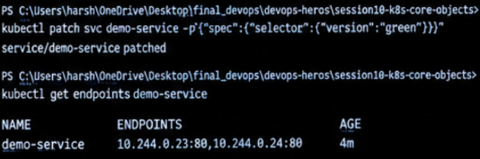

---

## 3. Canary Deployment

A Canary deployment introduces a new application version to a small portion of traffic before directing all traffic to it.

For this exercise, use an NGINX Ingress controller with weighted traffic routing. A standard Kubernetes Service alone does not guarantee a specific traffic percentage.

### Step 1: Create the Stable and Canary Deployments

Create `deployments/canary.yaml`:

```yaml
apiVersion: apps/v1
kind: Deployment
metadata:
  name: stable-app
spec:
  replicas: 9
  selector:
    matchLabels:
      app: canary-demo
      version: stable
  template:
    metadata:
      labels:
        app: canary-demo
        version: stable
    spec:
      containers:
        - name: nginx
          image: nginx:1.26
          ports:
            - containerPort: 80
---
apiVersion: apps/v1
kind: Deployment
metadata:
  name: canary-app
spec:
  replicas: 1
  selector:
    matchLabels:
      app: canary-demo
      version: canary
  template:
    metadata:
      labels:
        app: canary-demo
        version: canary
    spec:
      containers:
        - name: nginx
          image: nginx:1.27
          ports:
            - containerPort: 80
---
apiVersion: v1
kind: Service
metadata:
  name: stable-service
spec:
  selector:
    app: canary-demo
    version: stable
  ports:
    - port: 80
      targetPort: 80
---
apiVersion: v1
kind: Service
metadata:
  name: canary-service
spec:
  selector:
    app: canary-demo
    version: canary
  ports:
    - port: 80
      targetPort: 80
```

Apply and verify:

```powershell
kubectl apply -f deployments/canary.yaml
kubectl rollout status deployment/stable-app
kubectl rollout status deployment/canary-app
kubectl get pods -l app=canary-demo --show-labels
kubectl get services
```

### Step 2: Verify Both Versions

```powershell
kubectl get pods -l version=stable
kubectl get pods -l version=canary
kubectl get endpoints stable-service
kubectl get endpoints canary-service
```

### Step 3: Route a Small Percentage of Traffic

The two Deployments and Services above establish the stable and canary versions, but they do not implement weighted traffic routing by themselves.

To complete the percentage-based routing requirement, install and configure a compatible Ingress controller that supports canary routing, then create its stable Ingress and canary Ingress resources using that controller's documented annotations. Configure the canary weight to 10 and verify the routing behavior using repeated requests and the controller's metrics or logs.

For example, with a compatible ingress-nginx installation, the canary Ingress typically uses annotations such as:

```yaml
nginx.ingress.kubernetes.io/canary: "true"
nginx.ingress.kubernetes.io/canary-weight: "10"
```

These annotations belong on the canary Ingress resource. They have no effect unless the compatible controller is installed and configured.

### Observation

- The stable version serves normal traffic.
- The canary version is deployed alongside the stable version.
- A compatible weighted-routing controller can direct a small share of requests to the canary.
- A 10% weight is a routing target, not a guarantee that every small sample of requests will split exactly 90/10.

### Screenshots

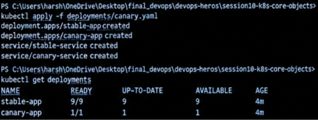

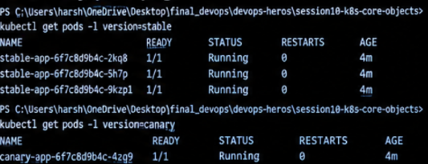

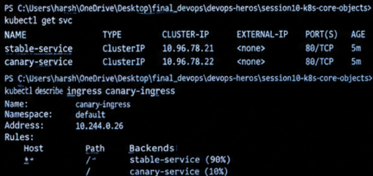

---

## 4. Recreate Deployment

The Recreate strategy terminates the existing application Pods before creating replacement Pods. This can cause downtime during the update.

### Step 1: Create the Deployment

Create `deployments/recreate.yaml`:

```yaml
apiVersion: apps/v1
kind: Deployment
metadata:
  name: recreate-app
spec:
  replicas: 3
  strategy:
    type: Recreate
  selector:
    matchLabels:
      app: recreate-app
  template:
    metadata:
      labels:
        app: recreate-app
        version: v1
    spec:
      containers:
        - name: nginx
          image: nginx:1.26
          ports:
            - containerPort: 80
```

Apply and verify:

```powershell
kubectl apply -f deployments/recreate.yaml
kubectl rollout status deployment/recreate-app
kubectl get pods -l app=recreate-app
```

### Step 2: Update the Application

```powershell
kubectl set image deployment/recreate-app nginx=nginx:1.27
kubectl rollout status deployment/recreate-app
```

### Step 3: Observe Pod Replacement

```powershell
kubectl get pods -l app=recreate-app -w
```

Press `Ctrl+C` to stop watching after the update completes.

Inspect the Deployment:

```powershell
kubectl describe deployment recreate-app
kubectl rollout history deployment/recreate-app
```

### Observation

- The old Pods are terminated before the replacement Pods are created.
- The application can become temporarily unavailable.
- The Recreate strategy is useful when two application versions must not run simultaneously.

### Screenshot

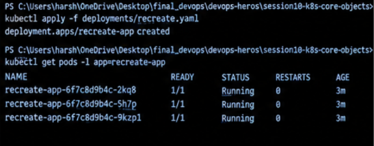

---

# Task 2: Kubernetes Pod Lifecycle

A Pod is the smallest deployable unit in Kubernetes. A Pod commonly moves through phases such as `Pending`, `Running`, `Succeeded`, or `Failed`. `Terminating` is a status commonly displayed while a Pod is being deleted, rather than a formal Pod phase.

The following examples demonstrate Pod creation, inspection, restart behavior, and deletion.

## 1. Pod Creation and Running

Create `pod-lifecycle/pod.yaml`:

```yaml
apiVersion: v1
kind: Pod
metadata:
  name: lifecycle-pod
spec:
  containers:
    - name: nginx
      image: nginx:1.26
      ports:
        - containerPort: 80
```

### Apply the YAML

```powershell
kubectl apply -f pod-lifecycle/pod.yaml
```

### Check Pod Status

```powershell
kubectl get pods
kubectl get pod lifecycle-pod -o wide
```

### Check Pod Details

```powershell
kubectl describe pod lifecycle-pod
kubectl get pod lifecycle-pod -o yaml
```

### Observation

The Pod may initially be `Pending` while Kubernetes schedules it and prepares the container. After the container starts successfully, its phase should become `Running`.

### Screenshot

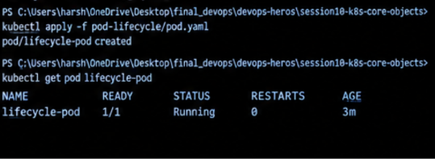

---

## 2. Pod Restart Behavior

Kubernetes can restart a container inside a Pod when it exits, depending on the Pod's restart policy. A simple way to demonstrate this behavior is to use a container that exits and has `restartPolicy: Always`.

Create `pod-lifecycle/pod-restart.yaml`:

```yaml
apiVersion: v1
kind: Pod
metadata:
  name: restart-pod
spec:
  restartPolicy: Always
  containers:
    - name: restart-demo
      image: busybox:1.36
      command: ["sh", "-c", "echo Container started; sleep 5; exit 1"]
```

### Apply the YAML

```powershell
kubectl apply -f pod-lifecycle/pod-restart.yaml
```

### Check Pod Status

```powershell
kubectl get pod restart-pod -w
```

Press `Ctrl+C` after observing the status and restart count.

### Check Pod Details and Logs

```powershell
kubectl describe pod restart-pod
kubectl logs restart-pod
kubectl logs restart-pod --previous
```

The previous-container logs may be available after a restart.

### Observation

The container exits after five seconds. Because the restart policy is `Always`, Kubernetes attempts to restart it. The Pod can remain in the `Running` phase while its container restarts, and the restart count increases.

### Screenshot

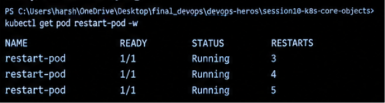

---

## 3. Pod Deletion and Termination

Create `pod-lifecycle/pod-delete.yaml`:

```yaml
apiVersion: v1
kind: Pod
metadata:
  name: delete-pod
spec:
  terminationGracePeriodSeconds: 10
  containers:
    - name: nginx
      image: nginx:1.26
      ports:
        - containerPort: 80
```

### Apply the YAML

```powershell
kubectl apply -f pod-lifecycle/pod-delete.yaml
```

### Check Pod Status and Details

```powershell
kubectl get pod delete-pod
kubectl describe pod delete-pod
```

### Delete the Pod

```powershell
kubectl delete pod delete-pod
```

To observe deletion in progress, run this in one terminal:

```powershell
kubectl get pod delete-pod -w
```

In another terminal, run:

```powershell
kubectl delete pod delete-pod
```

If the Pod terminates too quickly to observe, the absence of the Pod after deletion still confirms that the resource was removed.

### Verify Deletion

```powershell
kubectl get pods
```

### Observation

Kubernetes requests graceful termination of the Pod. The container is given a termination grace period before forceful termination if needed. After deletion, the Pod no longer appears in the list of existing Pods.

### Screenshot

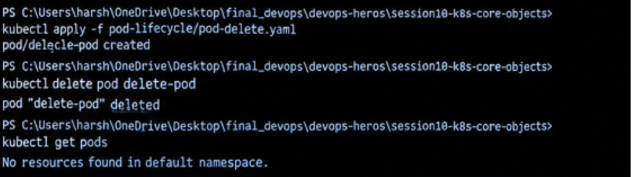

---

# Important Commands Reference

| Command | Purpose |
|---|---|
| `kubectl apply -f file.yaml` | Create or update resources from YAML |
| `kubectl get pods` | List Pods |
| `kubectl get deployments` | List Deployments |
| `kubectl get replicasets` | List ReplicaSets |
| `kubectl get services` | List Services |
| `kubectl get pods --show-labels` | Display Pod labels |
| `kubectl describe pod POD_NAME` | Inspect Pod details and events |
| `kubectl logs POD_NAME` | Display container logs |
| `kubectl get pods -w` | Watch Pod changes |
| `kubectl rollout status deployment/NAME` | Monitor a Deployment rollout |
| `kubectl rollout history deployment/NAME` | Inspect rollout revisions |
| `kubectl rollout undo deployment/NAME` | Roll back a Deployment |
| `kubectl delete -f file.yaml` | Delete resources defined in a manifest |

Replace placeholder values with actual resource names.

---

# Cleanup

After capturing the screenshots, delete the resources created for this session:

```powershell
kubectl delete -f deployments/rolling-update.yaml
kubectl delete -f deployments/blue-green.yaml
kubectl delete -f deployments/canary.yaml
kubectl delete -f deployments/recreate.yaml

kubectl delete -f pod-lifecycle/pod.yaml
kubectl delete -f pod-lifecycle/pod-restart.yaml
kubectl delete -f pod-lifecycle/pod-delete.yaml
```

If a manifest has already been deleted or a resource no longer exists, Kubernetes may report that the resource was not found. This does not mean that cleanup of the remaining resources failed.

---

# What I Learned

- The difference between Pods, ReplicaSets, and Deployments.
- How Rolling Update gradually replaces application Pods.
- How Blue-Green deployment switches traffic between two versions.
- Why Canary deployment requires a routing mechanism to control the percentage of traffic.
- How the Recreate strategy replaces old Pods before creating new ones.
- How to create, inspect, monitor, restart, and delete Pods.
- How to apply YAML manifests and use `kubectl` to observe Kubernetes behavior.
- How to document command outputs and practical observations.

---


---

# GitHub Submission

Run the following commands from the project root:

```powershell
git status
git add README.md deployments/ pod-lifecycle/ screenshots/
git commit -m "Complete Kubernetes deployments and pod lifecycle"
git push
```

Ensure the GitHub repository contains the README, YAML manifests, and screenshots.

---

# Learning Resources

- [Kubernetes Pods](https://kubernetes.io/docs/concepts/workloads/pods/)
- [ReplicaSets](https://kubernetes.io/docs/concepts/workloads/controllers/replicaset/)
- [Deployments](https://kubernetes.io/docs/concepts/workloads/controllers/deployment/)
- [Updating Deployments](https://kubernetes.io/docs/concepts/workloads/controllers/deployment/#updating-a-deployment)
- [Pod Lifecycle](https://kubernetes.io/docs/concepts/workloads/pods/pod-lifecycle/)
- [Ingress](https://kubernetes.io/docs/concepts/services-networking/ingress/)

---

## Conclusion

This session demonstrates how Kubernetes manages application updates and Pod lifecycles. Rolling Update and Recreate provide different update behaviors, Blue-Green switches between separately deployed versions, and Canary introduces a new version to a controlled portion of traffic. These exercises provide practical experience with Kubernetes workload management and resource inspection.