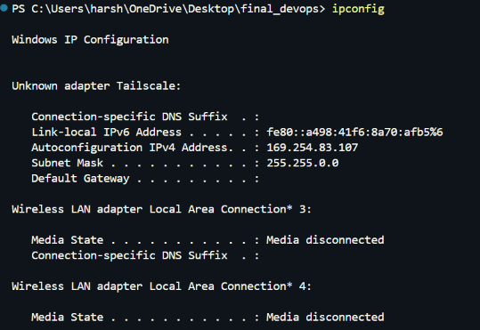
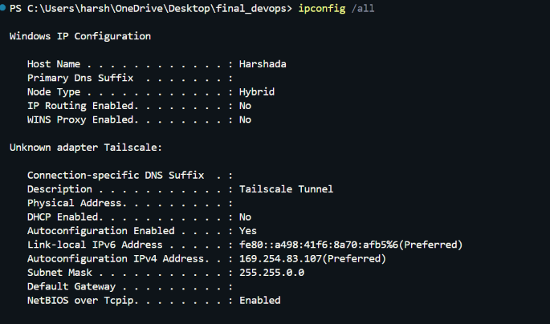
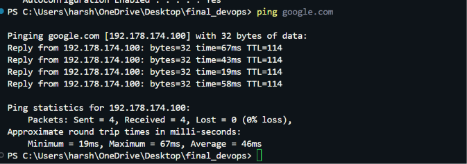
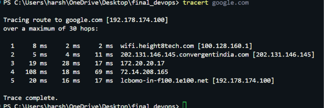
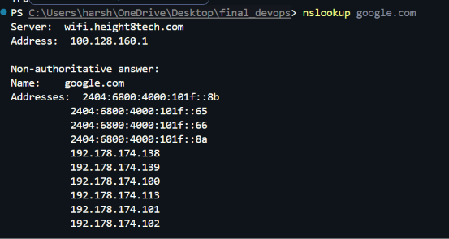
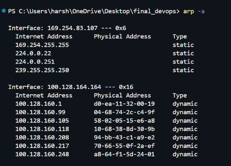
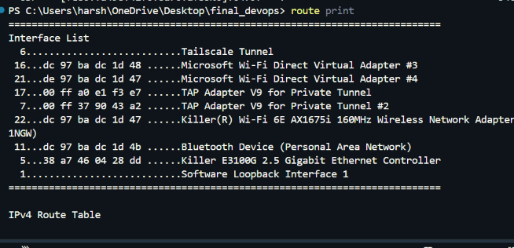
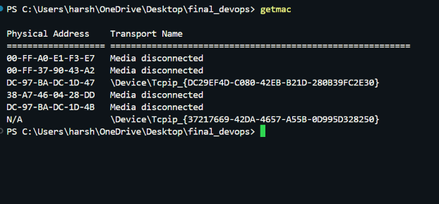

# Networking Homework


## Task 2: Execute Commands and Document Output

### 1. `ipconfig`

**Command:**
```powershell
ipconfig
```

**Understanding:** Displays the computer's IP address and network configuration.


**Filename:** `01_ipconfig.png`


<!-- Screenshot 1: 01_ipconfig.png -->



---

### 2. `ipconfig /all`

**Command:**
```powershell
ipconfig /all
```

**Understanding:** Displays detailed network adapter information, including MAC address and DNS servers.


**Filename:** `02_ipconfig_all.png`

<!-- Screenshot 2: 02_ipconfig_all.png -->



---

### 3. `ping google.com`

**Command:**
```powershell
ping google.com
```

**Understanding:** Checks connectivity to a destination and shows response times.


**Filename:** `03_ping.png`

<!-- Screenshot 3: 03_ping.png -->



---

### 4. `tracert google.com`

**Command:**
```powershell
tracert google.com
```

**Understanding:** Shows the network hops toward a destination.


**Filename:** `04_tracert.png`

<!-- Screenshot 4: 04_tracert.png -->



---

### 5. `nslookup google.com`

**Command:**
```powershell
nslookup google.com
```

**Understanding:** Queries DNS to find the IP address associated with a domain name.


**Filename:** `05_nslookup.png`

<!-- Screenshot 5: 05_nslookup.png -->



---

### 6. `arp -a`

**Command:**
```powershell
arp -a
```

**Understanding:** Displays cached mappings between local IPv4 addresses and MAC addresses.


**Filename:** `06_arp.png`

<!-- Screenshot 6: 06_arp.png -->



---

### 7. `netstat -ano`

**Command:**
```powershell
netstat -ano
```

**Understanding:** Displays network connections, listening ports, and process IDs.


**Filename:** `07_netstat.png`

<!-- Screenshot 7: 07_netstat.png -->


---

### 8. `route print`

**Command:**
```powershell
route print
```

**Understanding:** Displays the routing table used to determine where network packets are sent.


**Filename:** `08_route_print.png`

<!-- Screenshot 8: 08_route_print.png -->



---

### 9. `getmac`

**Command:**
```powershell
getmac
```

**Understanding:** Displays the MAC addresses of network adapters.


**Filename:** `09_getmac.png`




---

### 10. `hostname`

**Command:**
```powershell
hostname
```

**Understanding:** Displays the computer's name.


**Filename:** `10_hostname.png`

<!-- Screenshot 10: 10_hostname.png -->


---


