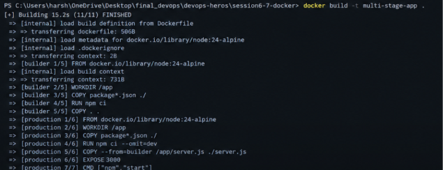
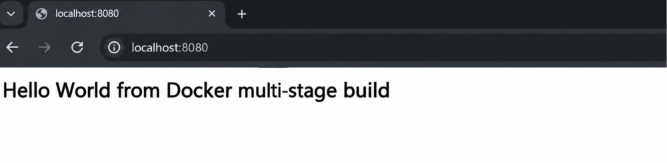
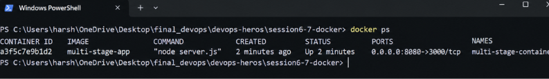
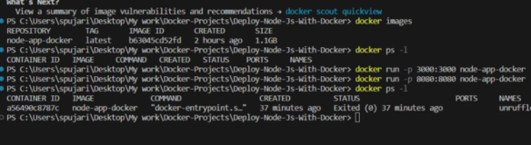

# Docker Multi-Stage Build and Application Deployment

**Name:** Harshada 
**Enrollment No.:** 24BCS10408  
**Working directory:** `session6-7-docker`

## 1. Multi-stage Docker build

The `multi-stage-dockerfile` project contains a Node.js application and a multi-stage `Dockerfile`. The build stage installs dependencies and prepares the application; the production stage creates the runtime image.

From the repository root, run:

```powershell
cd .\multi-stage-dockerfile
docker build -t multi-stage-app .
docker run -d --name multi-stage-container -p 8080:3000 multi-stage-app
docker ps
```

The command above assumes `server.js` listens on container port `3000`, as indicated by `EXPOSE 3000` in the Dockerfile. The mapping `8080:3000` makes it available at host port `8080`.

Open `http://localhost:8080` and verify the response:

```text
Hello World from Docker multi-stage build
```

If a container with the same name already exists, remove it before running again:

```powershell
docker rm -f multi-stage-container
```

### Evidence

Add your real screenshots to the `screenshots` folder and keep the filenames below, or change the paths to match your filenames.

**Multi-stage Dockerfile and successful image build**



**Application response in the browser**



**Running container and port mapping**



## 2. Deploy two application types

The workspace includes `node-app` and `python-app`. Build and run each application from its own directory, using the port specified by that application's code and Dockerfile.

### Node.js

```powershell
cd ..\node-app
docker build -t node-demo .
docker run -d --name node-demo-container -p 8081:3000 node-demo
docker ps
```

If the Node.js application listens on port `3000`, open `http://localhost:8081`. If it listens on a different port, update the right-hand side of the port mapping.

### Python

```powershell
cd ..\python-app
docker build -t python-demo .
docker run -d --name python-demo-container -p 8082:5000 python-demo
docker ps
```

If the Python application listens on port `5000`, open `http://localhost:8082`. If it uses another port or is a command-line application, adjust the port mapping or verify its output with:

```powershell
docker logs python-demo-container
```

### Evidence

**Node.js application**




## 3. Useful verification commands

```powershell
docker images
docker ps
docker logs multi-stage-container
```

- `docker images` lists locally built images.
- `docker ps` lists running containers and published ports.
- `docker logs` shows output from the selected container.

## 4. Submission checklist

- [ ] Build the multi-stage image successfully.
- [ ] Open `http://localhost:8080` and verify the expected message.
- [ ] Confirm the port mapping with `docker ps`.
- [ ] Build and run the Node.js application.
- [ ] Build and run the Python application.
- [ ] Replace the screenshot placeholders with screenshots captured from the actual running applications and terminal.
- [ ] Commit and push the README and screenshot files.

From the repository root:

```powershell
git status
git add session6-7-docker
git commit -m "Document Docker multi-stage build and app deployments"
git push
```
