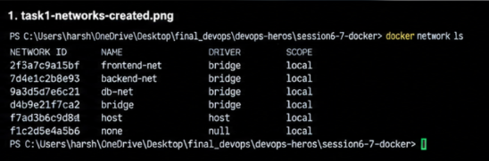
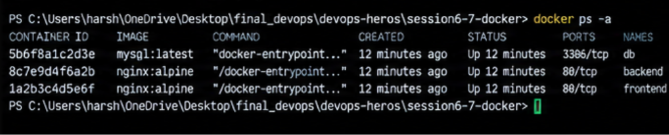
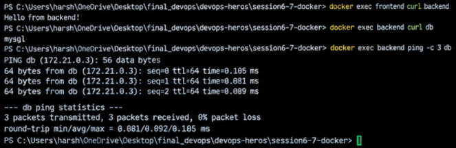
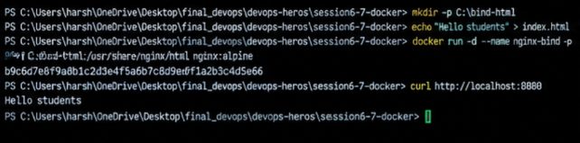
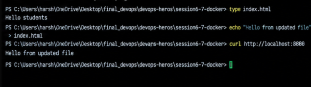
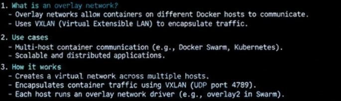

# Docker Networking & Volume Homework


## Task 1: Docker Container Networking

### Objective
Create frontend, backend, and database containers; create three separate bridge networks; attach the backend to two networks; and test connectivity.

### Example commands (PowerShell)

```powershell
docker network create frontend-net
docker network create backend-net
docker network create database-net

docker run -d --name frontend --network frontend-net nginx:alpine
docker run -dit --name backend alpine sh
docker run -d --name database --network database-net `
  -e MYSQL_ROOT_PASSWORD=ChangeThisPassword `
  mysql:8.0

docker network connect backend-net backend
docker network connect database-net backend

docker network inspect frontend-net
docker network inspect backend-net
docker network inspect database-net
docker ps
```

The backend is connected to both `backend-net` and `database-net`. The frontend is on `frontend-net`. Containers on separate bridge networks cannot normally communicate unless a container is attached to a shared network. For a connectivity test, ensure the backend image has the required tools installed (for example, install `iputils`/`ping` as appropriate for the image), then test the database name from the backend.

**Screenshots**

**1.1 — Networks created**


**1.2 — Containers and network attachments**


**1.3 — Connectivity test**


## Task 2: Host Network

### Objective
Pull Apache HTTP Server and attempt to run it with host networking.

```powershell
docker pull httpd:2.4
docker run -d --name apache-host --network host httpd:2.4
docker ps
```

Then try opening `http://localhost:80` in a browser.

**Important:** Docker host networking support depends on the platform and Docker Desktop configuration. On Windows, Linux-container host networking may require enabling the relevant Docker Desktop feature and may not behave exactly like native Linux. If `localhost:80` does not work, capture the actual error and explain your Docker Desktop limitation rather than presenting a successful result that did not occur.

**Screenshot**


## Task 3: Bind Mount

### Objective
Serve a local `index.html` from an Nginx container and verify host-file edits appear without restarting the container.

```powershell
mkdir .\site
Set-Content .\site\index.html 'Hello students'

docker run -d --name nginx-bind -p 8080:80 `
  -v "${PWD}\site:/usr/share/nginx/html:ro" nginx:alpine

curl.exe http://localhost:8080
```

Expected first response:

```text
Hello students
```

Edit the file on the host:

```powershell
Set-Content .\site\index.html 'Hello Docker students - updated'
curl.exe http://localhost:8080
```

The second response should show the updated content without restarting the container. If the container name already exists, remove the old one first with `docker rm -f nginx-bind`.

**Screenshots**

**3.1 — Initial bind mount and content**


**3.2 — Updated content without restart**


## Task 4: Overlay Network

### Research notes
- An overlay network connects containers or services running on different Docker hosts.
- Docker Swarm uses overlay networking to provide multi-host service communication and service discovery.
- Overlay traffic is encapsulated (commonly using VXLAN) so it can traverse the host network.
- A Swarm overlay network can be created with `docker network create --driver overlay app-overlay` after Swarm is initialized.
- Overlay networking is useful for distributed applications, especially services spread across multiple nodes.
- A normal bridge network is generally sufficient for containers on one Docker host.
- Multi-host behavior requires multiple participating Docker hosts/nodes; creating an overlay network alone does not demonstrate cross-host communication.

**Screenshot / research notes**



## Submission Checklist

- [ ] Replace all illustrative images with real screenshots from your own machine.
- [ ] Show `docker network ls` and `docker network inspect` output for Task 1.
- [ ] Show a real connectivity test and its result.
- [ ] Show Apache's actual host-network result (including any Docker Desktop limitation).
- [ ] Show the initial and updated bind-mount response.
- [ ] Include your overlay-network research notes.
- [ ] Confirm the screenshots display readable commands and outputs.
