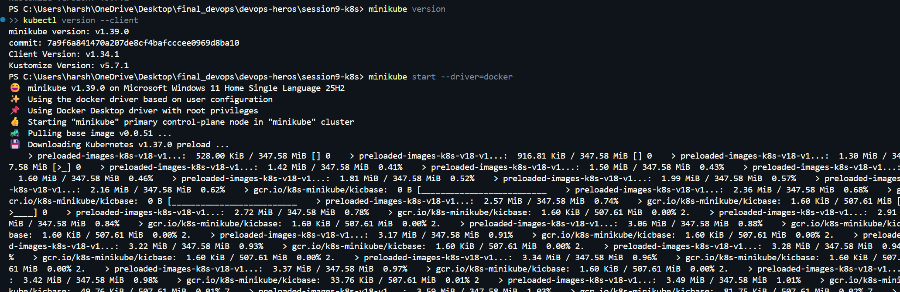
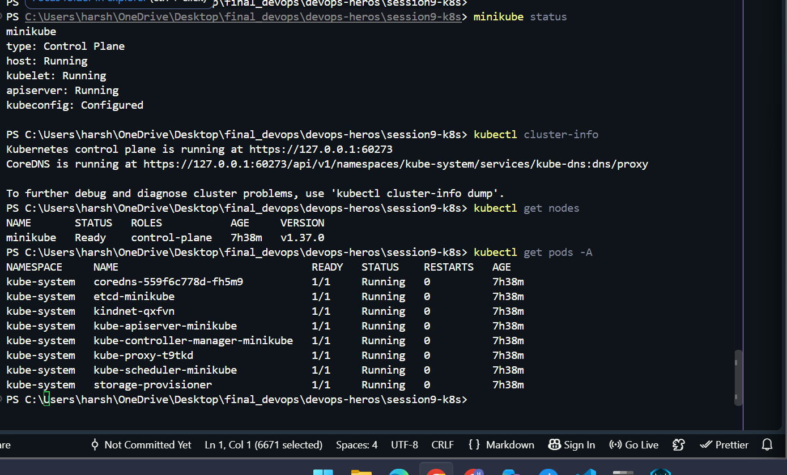
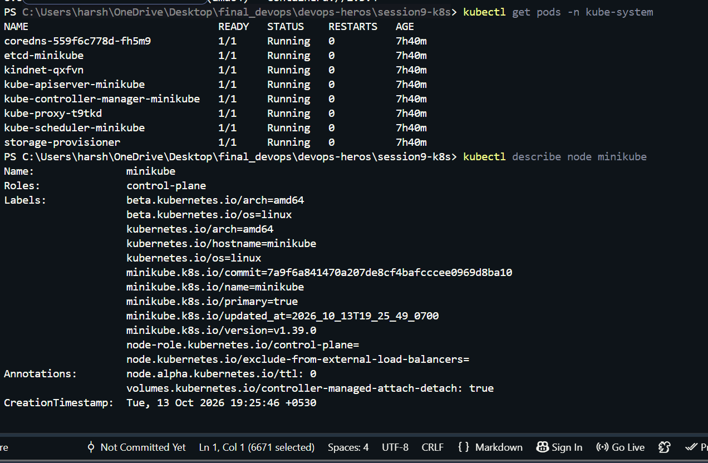
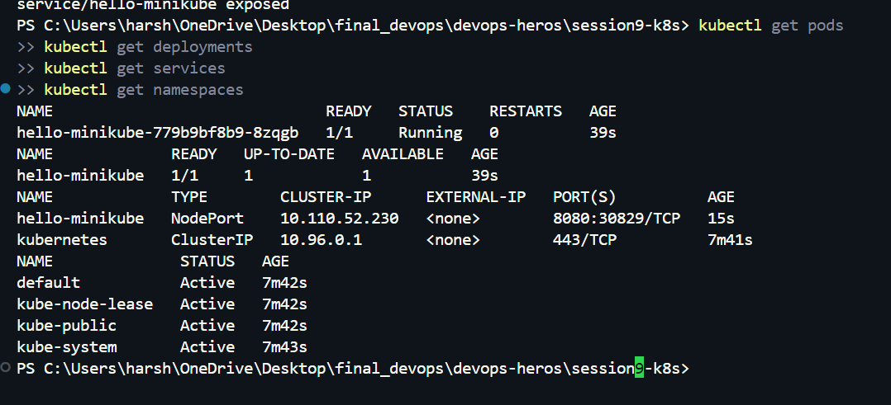
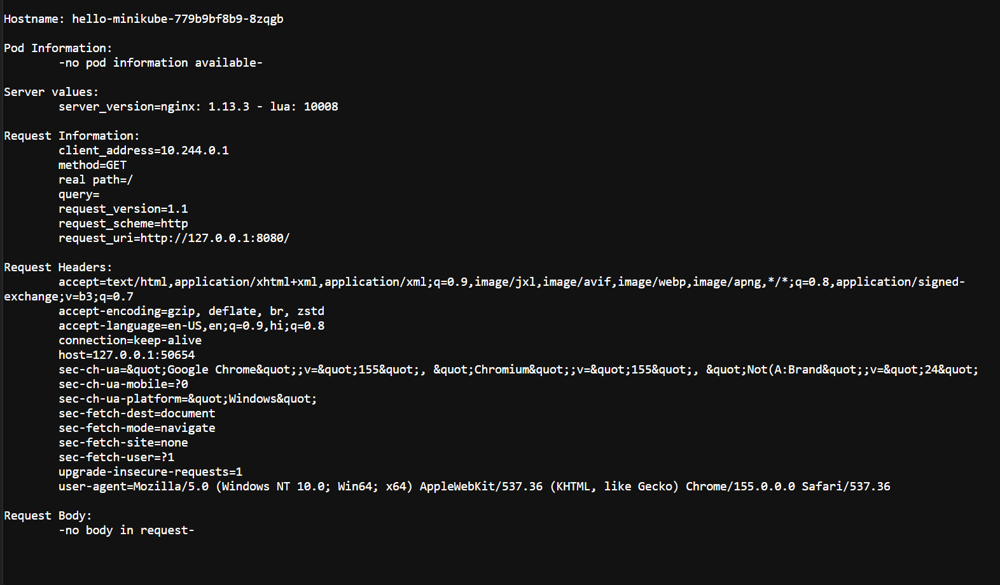

# Minikube and Kubernetes Basics

## Overview

This task covers installing and configuring Minikube, verifying a local Kubernetes cluster, exploring Kubernetes architecture, learning basic Kubernetes objects and commands, and completing the Kubernetes Basics hands-on tutorial.

## Objectives

- Install and configure Minikube.
- Verify the Kubernetes cluster status.
- Explore Kubernetes architecture.
- Learn basic Kubernetes objects and commands.
- Complete the Kubernetes Basics hands-on tutorial.

## Environment

- **Operating system:** Windows
- **Terminal:** PowerShell
- **Local Kubernetes environment:** Minikube
- **Container driver:** Docker (requires Docker Desktop)
- **CLI:** `kubectl`

## 1. Install and Configure Minikube

Minikube runs a local Kubernetes cluster for learning and development. Docker Desktop is used as the container driver for this setup.

Installation and setup commands used:

```powershell
winget install Kubernetes.minikube
winget install Kubernetes.kubectl
```

After installation, start the cluster:

```powershell
minikube start --driver=docker
```

Verify the installed tools:

```powershell
minikube version
kubectl version --client
```

### Screenshot — Installation and Configuration

<!-- Add screenshot here: Minikube and kubectl versions, followed by a successful minikube start. -->



## 2. Verify Kubernetes Cluster Status

Check that Minikube is running and that Kubernetes can communicate with the cluster.

```powershell
minikube status
kubectl cluster-info
kubectl get nodes
kubectl get pods -A
```

The node should eventually show `Ready`. Some system pods may take a little time to become ready after the cluster starts.

### Screenshot — Cluster Status

<!-- Add screenshot here: minikube status, kubectl cluster-info, and kubectl get nodes showing Ready. -->



## 3. Explore Kubernetes Architecture

A Kubernetes cluster has two main parts:

- **Control plane:** Manages the cluster and makes decisions about scheduling and desired state.
- **Worker node(s):** Run application workloads in Pods.

Important components:

| Component | Purpose |
|---|---|
| API server | Entry point for Kubernetes API requests |
| etcd | Stores Kubernetes cluster state and configuration data |
| Scheduler | Selects a suitable node for newly created Pods |
| Controller manager | Runs controllers that help maintain the desired state |
| kubelet | Ensures assigned Pods and containers are running on a node |
| Container runtime | Runs containers, such as containerd |
| kube-proxy | Implements Service network rules on clusters that use it |

Useful commands to inspect the cluster:

```powershell
kubectl get nodes -o wide
kubectl get pods -n kube-system
kubectl describe node minikube
```

### Screenshot — Kubernetes Architecture Exploration

<!-- Add screenshot here: Kubernetes system components in the kube-system namespace and node details. -->



## 4. Learn Basic Kubernetes Objects and Commands

Kubernetes objects describe the desired state of applications and cluster resources.

| Object | What it does |
|---|---|
| Pod | Smallest deployable unit; runs one or more closely related containers |
| Deployment | Manages replicated Pods and supports updates |
| Service | Provides a stable way to access a set of Pods |
| Namespace | Organizes resources within a cluster |
| ConfigMap | Stores non-sensitive configuration data |
| Secret | Stores sensitive configuration data; secure handling and encryption depend on cluster configuration |

Common commands:

```powershell
kubectl get all
kubectl get pods
kubectl get deployments
kubectl get services
kubectl get namespaces
kubectl describe pod <pod-name>
kubectl logs <pod-name>
kubectl apply -f <file.yaml>
kubectl delete -f <file.yaml>
```

### Screenshot — Basic Objects and Commands

<!-- Add screenshot here: output from kubectl get pods, kubectl get deployments, kubectl get services, and kubectl get namespaces. -->



## 5. Perform the Kubernetes Basics Hands-on Tutorial

The hands-on exercise creates a Deployment, exposes it through a Service, scales the Deployment, and updates the application image.

### Create a Deployment

```powershell
kubectl create deployment hello-minikube --image=registry.k8s.io/echoserver:1.10
kubectl get deployments
kubectl get pods
```

### Expose the Deployment

```powershell
kubectl expose deployment hello-minikube --type=NodePort --port=8080
kubectl get services
minikube service hello-minikube
```

The last command opens the service in a browser. Keep the terminal open if Minikube needs it to provide access to the service.

### Scale the Deployment

```powershell
kubectl scale deployment hello-minikube --replicas=2
kubectl get deployments
kubectl get pods
```

### Update the Deployment Image

```powershell
kubectl set image deployment/hello-minikube echoserver=registry.k8s.io/echoserver:1.10
kubectl rollout status deployment/hello-minikube
```

This image update uses the same image as the original deployment to demonstrate the rollout command. It may not result in a visible application change.

### Clean Up the Tutorial Resources

```powershell
kubectl delete service hello-minikube
kubectl delete deployment hello-minikube
```

### Screenshot — Kubernetes Basics Hands-on Tutorial

<!-- Add screenshot here: Deployment and Pods running, Service created, browser response, and scaling result. -->



## Useful Troubleshooting Commands

```powershell
minikube status
minikube logs
kubectl get events --sort-by=.metadata.creationTimestamp
kubectl describe pod <pod-name>
kubectl config current-context
```

If Minikube cannot start with the Docker driver, make sure Docker Desktop is installed and running, then retry:

```powershell
minikube start --driver=docker
```

## Conclusion

This task demonstrates how to run a local Kubernetes cluster with Minikube, check cluster health, inspect architecture-related components, work with common Kubernetes objects, and practice creating, exposing, scaling, and updating a Deployment.

